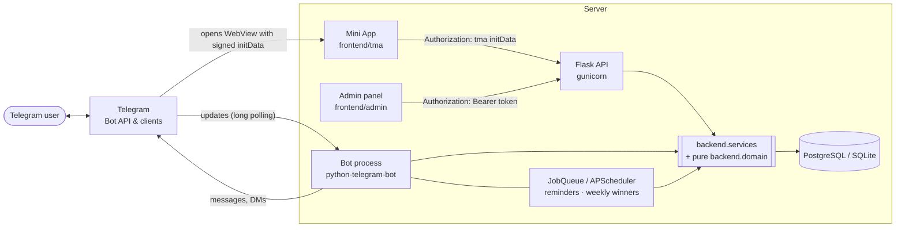
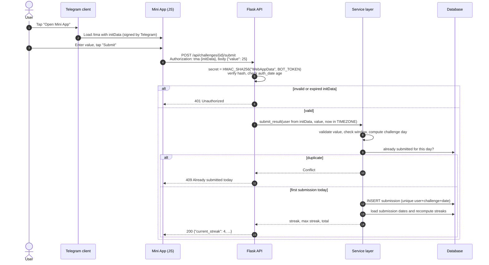

# Qadam Club Bot

**A Telegram bot + Telegram Mini App for daily habit challenges: submit your result once a day, keep your streak alive, and climb the leaderboard.**

[](https://github.com/samandar-hamrayev/Qadam-Club-Bot/actions/workflows/ci.yml)


[](LICENSE)

Qadam ("step" in Uzbek) Club runs community challenges such as *read N pages every evening* or *walk N steps a day*. Members join from a Telegram Mini App (or plain bot commands), submit one result per day, and the backend tracks streaks, totals and weekly winners. Every Mini App request is authenticated with Telegram's signed `initData`, and all day-based logic runs in an explicit, configurable timezone (default `Asia/Tashkent`).

<!-- Screenshots: add images to docs/ and uncomment.
<p align="center">
  
  
  
</p>
-->

## Features

- **Telegram Mini App**: list challenges, join, and submit today's result from inside Telegram.
- **Bot commands**: `/start`, `/submit`, `/<challenge_code> [value]` and `/cancel` for members who prefer chat.
- **Verified identity**: the API validates Telegram WebApp `initData` (HMAC-SHA256, `auth_date` freshness). It never trusts a user id sent by the client.
- **Streaks by local date**: current and longest streak are computed over calendar days in the club timezone. A streak stays alive until a whole day is missed.
- **Time-gated submissions**: an optional `HH:MM–HH:MM` window per challenge, including windows that cross midnight (`22:00–01:00` counts toward the previous day).
- **One submission per day**: checked in code and enforced by a database unique constraint, so concurrent requests can't create duplicates.
- **Leaderboards**: totals for today, this week, this month or all time (ties share a rank), plus a streak leaderboard that shows stale streaks as 0.
- **Scheduled jobs**: a daily reminder for members who haven't submitted yet, and weekly winners on Monday, saved idempotently and announced by DM.
- **Admin API and panel**: create, edit and deactivate challenges; list, ban and unban users. Protected by a bearer token or an admin's `initData`.
- **Interactive API docs**: Swagger UI at `/apidocs/`.
- **Production setup**: gunicorn, non-root Docker image with healthchecks, PostgreSQL in Compose, CI with lint, tests, image build and secret scanning.

## Architecture



The HTTP API and the bot are two processes built from the same image. Both call **one service layer** (`backend/services.py`), which combines the database with **pure domain functions** (`backend/domain/`) that have no I/O and are unit-tested in isolation. The bot therefore never needs to forward a user id over HTTP: it takes the identity from the Telegram update and writes through the same rules as the API.

### Daily submission from the Mini App



## Design decisions

| Decision | Why |
|---|---|
| Authenticate the Mini App with `initData` in an `Authorization: tma …` header | The original API accepted `telegram_id` from the request body, so anyone could act as anyone. `initData` is signed with a key derived from the bot token, so the backend can verify it without a session store or a login flow. |
| Reject `initData` older than `INIT_DATA_MAX_AGE` (default 24h) and from the future | A leaked `initData` string can't be replayed forever. |
| Admin access by `ADMIN_API_TOKEN` (constant-time compare) or an admin's `initData` | Replaces the old "send any admin id in the body" check. There are no hardcoded passwords; the token comes from the environment. |
| Pure `backend/domain` package (streaks, windows, ranking, value validation) | The rules that matter most can be tested exhaustively without Flask, a database or Telegram. |
| One service layer used by the API, the bot and the jobs | The rules live in one place. The bot previously called its own API over HTTP with a client-supplied user id, using blocking `requests` inside async handlers. |
| Streaks recomputed from the stored submission dates | The streak can always be rebuilt from history, and a missed day can't be hidden by a counter that drifted. |
| An explicit `TIMEZONE` for every "today" | Servers often run in UTC. 23:30 and 00:30 in Tashkent fall on the same UTC date, which broke streaks and the duplicate check. |
| `challenge_day()` for windows that cross midnight | Someone who submits at 00:30 inside a `22:00–01:00` window still extends yesterday's streak. |
| Unique constraint on `(user, challenge, date)` | Two simultaneous requests can't both pass the "already submitted?" check. |
| PTB `JobQueue` (APScheduler) with timezone-aware triggers | The old `AsyncIOScheduler` was started outside the bot's event loop and got the wrong context object. Jobs now run inside the application with the bot available. |
| Weekly results are idempotent and ties share first place | Re-running the job doesn't duplicate rows, and equal totals are ranked fairly. |
| Gunicorn `--preload` and disposing the start-up connection pool | The schema is created once, and forked workers never share a database connection. |

## Tech stack

| Layer | Technology |
|---|---|
| Language | Python 3.12 |
| Web API | Flask 3, flasgger (Swagger UI), gunicorn |
| Bot and scheduling | python-telegram-bot 21+ with JobQueue (APScheduler) |
| Data | SQLAlchemy 2 ORM; PostgreSQL 17 (Compose) or SQLite (local) |
| Frontend | Vanilla HTML/JS Telegram Mini App and admin panel |
| Quality | pytest and pytest-cov, ruff (lint and format), pre-commit, gitleaks |
| Delivery | Docker (multi-stage, non-root), Docker Compose, GitHub Actions, Dependabot |

## Quick start

### 1. Create the bot and the Mini App in Telegram

1. Open [@BotFather](https://t.me/BotFather), run `/newbot`, and copy the token into `BOT_TOKEN`.
2. Expose the web service over **HTTPS**. Mini Apps require it. For local development, use something like `ngrok http 18400` (Docker) or `ngrok http 5000` (local).
3. Set `WEBAPP_URL` to that HTTPS origin, e.g. `https://abc123.ngrok-free.app`. `/start` opens `<WEBAPP_URL>/tma`.
4. Optional: in BotFather, use `/mybots` → *Bot Settings* → *Menu Button* (or `/newapp`) to add the same `/tma` URL as the bot's menu button.
5. Put your Telegram user id in `ADMIN_IDS`, and generate an admin token:
   `python -c "import secrets; print(secrets.token_urlsafe(32))"` → `ADMIN_API_TOKEN`.

### 2a. Run with Docker (PostgreSQL + web + bot)

```bash
cp .env.example .env        # fill BOT_TOKEN, ADMIN_API_TOKEN, WEBAPP_URL, ADMIN_IDS
docker compose up --build -d
curl http://localhost:18400/healthz   # {"status":"ok","database":"ok"}
```

- Mini App: `<WEBAPP_URL>/tma` · Admin panel: `<WEBAPP_URL>/admin-panel` · API docs: `http://localhost:18400/apidocs/`
- Set `WEB_PORT` to change the host port (default `18400`).
- Without a `BOT_TOKEN`, the web service still starts and is healthy, but Mini App endpoints answer `503`. The `bot` container logs `BOT_TOKEN is not set` and Docker keeps restarting it.

### 2b. Run locally (SQLite)

```bash
make install                # creates .venv, installs deps and pre-commit hooks
cp .env.example .env        # fill in values
make run-web                # Flask dev server on http://127.0.0.1:5000
make run-bot                # in a second terminal
```

### 3. Create a challenge

Open `/admin-panel`, paste your `ADMIN_API_TOKEN` when asked, and create a challenge, e.g. title *Book Challenge*, code `book`, unit `pages`, window `21:00`–`23:59`. Or use the API:

```bash
curl -X POST http://localhost:18400/api/admin/challenges \
  -H "Authorization: Bearer $ADMIN_API_TOKEN" -H "Content-Type: application/json" \
  -d '{"title":"Book Challenge","code":"book","target_unit":"pages","time_window_start":"21:00","time_window_end":"23:59"}'
```

## Configuration

All configuration comes from environment variables. A `.env` file is loaded for convenience in development. See [`.env.example`](.env.example).

| Variable | Default | Description |
|---|---|---|
| `BOT_TOKEN` | — | Bot token from @BotFather. Required by the bot; the API uses it to verify `initData`. |
| `WEBAPP_URL` | — | Public HTTPS base URL. The bot's button opens `<WEBAPP_URL>/tma`. (`PYTHONANYWHERE_DOMAIN` is still accepted.) |
| `ADMIN_IDS` | — | Comma-separated Telegram ids seeded as admins. |
| `ADMIN_API_TOKEN` | — | Bearer token for `/api/admin/*` (at least 24 chars). If unset, only an admin's `initData` works. |
| `DATABASE_URL` | `sqlite:///qadam_club.db` | SQLAlchemy URL. Compose sets PostgreSQL. |
| `POSTGRES_PASSWORD` | `qadam-dev-password` | Password for the bundled PostgreSQL (Compose only). |
| `TIMEZONE` | `Asia/Tashkent` | IANA timezone for windows, streak days and schedules. |
| `REMINDER_TIME` | `21:00` | Daily reminder time (`HH:MM`, in `TIMEZONE`). |
| `INIT_DATA_MAX_AGE` | `86400` | Maximum age of `initData` in seconds (minimum 60). |
| `FLASK_DEBUG` | `false` | Debug mode for the development server only. |
| `PORT` / `WEB_CONCURRENCY` | `8000` / `2` | Port and number of gunicorn workers in the container. |
| `WEB_PORT` | `18400` | Host port that Compose publishes. |

## API overview

Mini App endpoints need `Authorization: tma <initData>`. Admin endpoints need `Authorization: Bearer <ADMIN_API_TOKEN>`, or the `tma` header of a user listed in `ADMIN_IDS`. Errors come back as `{"error": "...", "code": "..."}`. The full schema is in Swagger at `/apidocs/`.

| Method | Path | Auth | Description |
|---|---|---|---|
| `GET` | `/healthz` | — | Liveness and database check |
| `POST` | `/api/auth/register` | tma | Create or update the caller from `initData` |
| `GET` | `/api/challenges/` | tma | Active challenges with `is_joined` |
| `POST` | `/api/challenges/{id}/join` | tma | Join a challenge |
| `POST` | `/api/challenges/{id}/submit` | tma | `{"value": n}`. Returns `400` invalid value, `403` banned, `409` duplicate, `422` outside the window |
| `GET` | `/api/leaderboard/?challenge_id=&period=` | tma | Top 10 by total; `period` is `today`, `weekly`, `monthly` or `all` |
| `GET` | `/api/leaderboard/streaks?challenge_id=` | tma | Top 10 by current streak |
| `GET` / `POST` | `/api/admin/challenges` | admin | List all challenges / create one |
| `PATCH` | `/api/admin/challenges/{id}` | admin | Update whitelisted fields |
| `GET` | `/api/admin/users?limit=&offset=` | admin | List users |
| `POST` | `/api/admin/users/{id}/ban` · `/unban` | admin | Ban or unban a user |

## Testing

```bash
make test     # 162 tests
make cov      # with a coverage report (about 93%)
make lint     # ruff check + ruff format --check
```

The tests use in-memory SQLite and an injected clock, so day boundaries can be simulated, and they never call the Telegram API: bot handlers and jobs run against fakes. They cover:

- **initData**: valid data, tampered `user` or `hash`, a hash from another bot, expired and future `auth_date`, malformed input.
- **Streaks**: consecutive days, gaps, month, year and leap-day boundaries, and local vs UTC dates (23:30 → 00:30 Tashkent).
- **Submission window**: inclusive edges, 23:59:59, midnight, overnight windows.
- **Weekly winners**: ranking with ties, idempotent persistence.
- **Flask routes**: authentication required, forged credentials rejected, admin protection, happy path, duplicates, validation, bans, leaderboards.

## Project structure

```
Qadam-Club-Bot/
├── backend/
│   ├── app.py                 # Flask app factory, error handlers, /healthz, static pages
│   ├── wsgi.py                # gunicorn entry point
│   ├── auth.py                # require_tma_user / require_admin decorators
│   ├── telegram_init_data.py  # initData HMAC validation (pure)
│   ├── services.py            # use cases shared by API, bot and jobs
│   ├── domain/                # pure rules: streaks, window, ranking, values
│   ├── models.py, database.py # SQLAlchemy models, engine and session scope
│   └── routes/                # auth, challenges, leaderboard, admin blueprints
├── bot/
│   ├── bot.py                 # entry point (python -m bot.bot)
│   ├── handlers.py            # /start, /submit, /<code> [value], /cancel
│   ├── parsing.py             # pure command parsing
│   └── scheduler.py           # daily reminders, weekly winners, heartbeat
├── frontend/
│   ├── tma/index.html         # Telegram Mini App
│   └── admin/index.html       # admin panel
├── tests/                     # pytest suite
├── config.py                  # typed Settings loaded from the environment
├── Dockerfile, docker-compose.yml
└── .github/                   # CI workflow, Dependabot
```

## Roadmap

- [ ] Alembic migrations. The schema is currently created with `create_all`, so new constraints only apply to fresh databases.
- [ ] Leaderboard and personal history screens in the Mini App.
- [ ] Monthly results and challenge seasons.
- [ ] Webhook mode for the bot as an alternative to long polling.
- [ ] Rate limiting on submission endpoints.
- [ ] Localization of bot and API messages (currently Uzbek UI text with English API errors).

## License

[MIT](LICENSE) © 2026 Samandar Hamrayev
